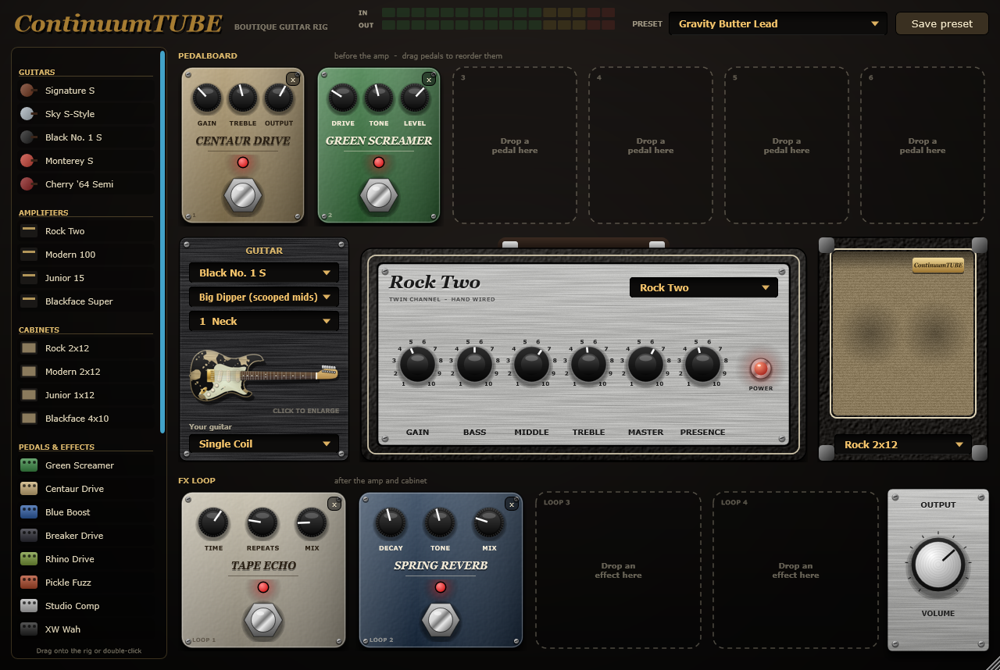
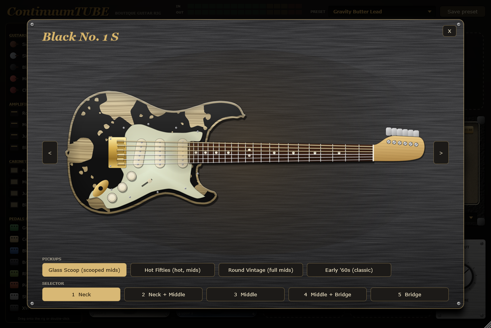
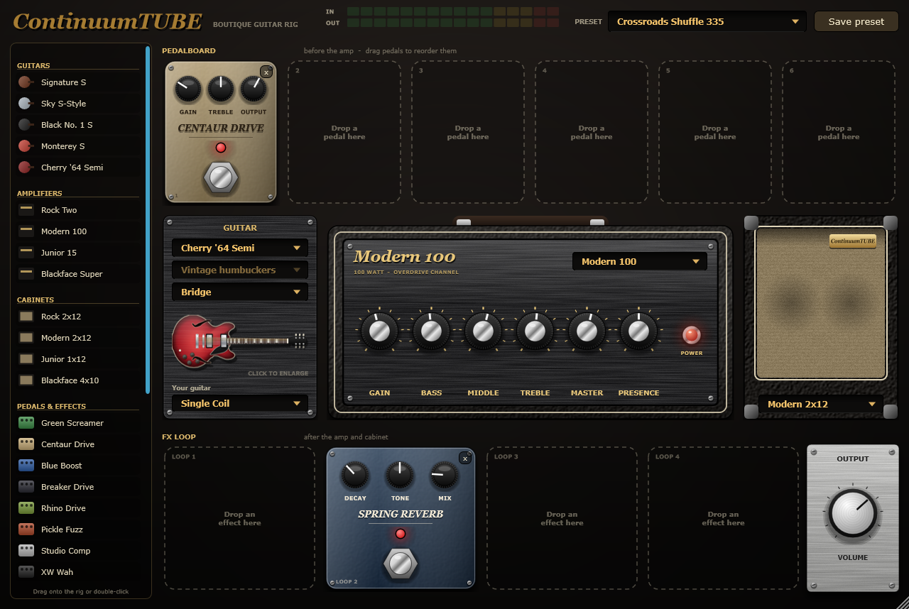

<p align="center">
  
</p>

<h1 align="center">ContinuumTUBE</h1>

<p align="center">
  <b>A John Mayer Fan guitar rig for Windows — five guitars, four tube amps, twenty-two pedals and a looper.</b><br>
  VST3 plugin + standalone app · free to use
</p>

<p align="center">
  <a href="https://ale-studios.github.io/ContinuumTUBE/"><b>Website & video</b></a> ·
  <a href="../../releases/latest"><b>Download</b></a> ·
  <a href="MANUAL.md">Manual</a> ·
  <a href="LICENSE.md">License</a>
</p>

---

ContinuumTUBE is a complete signal chain in one window:

```
your guitar  →  guitar model  →  6 pedal slots  →  amp  →  cabinet  →  4 FX-loop slots  →  looper  →  out
```

Plug a guitar into your audio interface, pick a preset, play. Or build your own rig by dragging
guitars, amps, cabinets and pedals from the library — and save it.

## What's inside

**Guitars** — each with switchable pickup sets and a real 5-way (or 3-way) selector.
Pick the model and ContinuumTUBE reshapes the pickup response of the guitar you're actually playing.

| | | |
|---|---|---|
| **Signature S** | sunburst S-style | scooped, glassy |
| **Sky S-Style** | silver S-style | round vintage mids |
| **Black No. 1 S** | worn black relic | fat and warm |
| **Monterey S** | hand-painted S-style | bright, barking attack |
| **Cherry '64 Semi** | semi-hollow, twin humbuckers | thick, woody, hot |

**Amps** — four very different circuits, each paired with its own cabinet (switch amp, the cab follows).

| | |
|---|---|
| **Rock Two** · 2x12 | huge, chimey clean with forward mids |
| **Modern 100** · 2x12 | singing, compressed overdrive channel |
| **Junior 15** · 1x12 | small combo that breaks up early |
| **Blackface Super** · 4x10 | scooped, sparkling, lots of headroom |

**Pedals & effects** — overdrives, a fuzz, boost, compressor, wah, envelope filter, octave,
vibe, phaser, chorus, tremolo, analog and tape delay, spring, studio and hall reverb.

**Stack Looper** — a four-track looper at the end of the chain. Hit the footswitch and it starts
recording on your first note, with every effect you're using; layer up to four tracks, mute or
clear each one. Loops keep playing when you change preset, so you can loop a clean rhythm and
solo over it with a lead sound.

**15 song-inspired presets** — mostly clean or just breaking up, like the songs, with a few
crunch and lead sounds that each use a different kind of drive. All set to a similar volume.
Full list in the [manual](MANUAL.md#presets).

<table>
<tr>
<td width="50%"><br><sub>Click a guitar for the large view: pickups and selector, up close.</sub></td>
<td width="50%"><br><sub>The semi-hollow into the Modern 100 overdrive channel.</sub></td>
</tr>
</table>

## Download & install

1. Download **`ContinuumTUBE-1.1.0-Windows.zip`** from [Releases](../../releases/latest) and unzip it.
2. **Standalone:** run `ContinuumTUBE.exe`, open **Options → Audio/MIDI Settings**, choose your
   audio interface's input and output.
3. **Plugin:** copy the `ContinuumTUBE.vst3` folder into `C:\Program Files\Common Files\VST3`,
   then rescan plugins in your DAW.

> Windows may show *"Windows protected your PC"* the first time, because the app isn't code-signed.
> Click **More info → Run anyway**.

**Requirements:** Windows 10 / 11 (64-bit), an audio interface with an instrument input,
any VST3 host for the plugin.

**Low latency:** in the standalone app choose **Windows Audio (Low Latency Mode)** and the
smallest buffer that plays without crackles. Inside a DAW, the plugin uses the DAW's own driver
(ASIO included).

## Privacy

ContinuumTUBE works fully offline. No account, no telemetry, no network access.
It only writes its own settings and the presets you save (`Documents\ContinuumTUBE Presets`).

## Good to know

- Every model is an original simulation tuned by ear from public descriptions of the
  instruments that inspired it. It aims to get you close to a sound, not to clone a specific
  recording.
- All guitar artwork in the app is original illustration. Model and preset names are original;
  see [NOTICES.md](NOTICES.md).

## License

Free to use, not open source. See [LICENSE.md](LICENSE.md).
